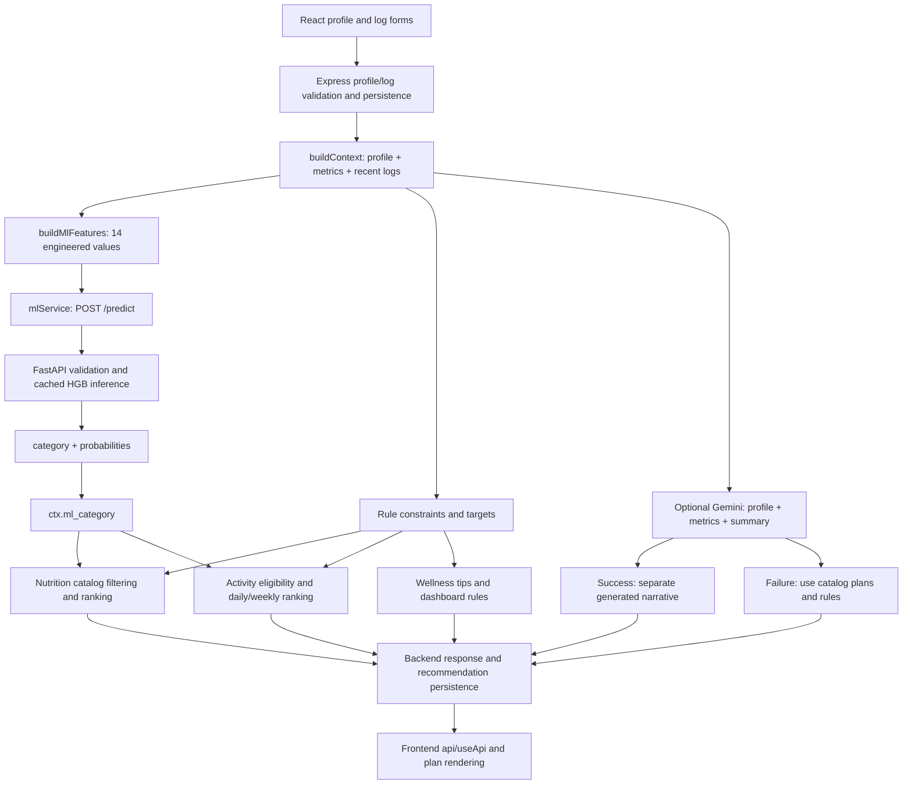

# ML-to-recommendation integration audit — 2026-10-16

## Executive summary

**Overall verdict: PARTIALLY CONNECTED.** The HGB classifier is connected to catalog
nutrition, daily activity and weekly activity ranking. Controlled tests prove that
changing only its returned category changes selected foods/activities. The live ML
service serves predictions matching the saved candidate. However, wellness tips,
dashboard rule recommendations and generated Gemini narrative do **not** depend on
the ML prediction. The complete currently authenticated website flow remains
unverified; frontend source wiring and compilation are confirmed.

Gemini failure does **not** inherently disable ML: when ML succeeds, the fallback
preserves its category/probabilities and category-based catalog ranking. If ML also
fails, the category becomes null and recommendations use rules alone. Gemini success
adds independent narrative alongside existing catalog plans and replaces wellness
tips with generated text. A healthy `/ml` page alone cannot establish these paths.

Important confirmed defects are missing validation of successful ML response bodies,
the separate LLM dietary-enforcement gap, and stale raw-input preprocessing in the
running ML process. No remediation was applied during this audit.

All profiles used for executable tests were synthetic. The model was trained on
synthetic data; neither accuracy nor model probabilities establish clinical validity.

## Evidence levels and scope

- **CONFIRMED:** direct source evidence, a passing behavioral test, or observed live
  response. Each statement below indicates which evidence applies.
- **PARTIALLY CONFIRMED:** source/test wiring exists, but the complete current live
  connection has not been demonstrated.
- **NOT CONNECTED:** the source path does not consume the ML prediction.
- **UNKNOWN:** insufficient current evidence.

Existing local listeners were used without restart, termination or port changes:
ML `127.0.0.1:8000` PID 1824; backend `127.0.0.1:5000` PID 2064; Vite `::1:5173`
PID 3492. Health checks and unauthenticated requests do not access personal profiles.
Authenticated recommendation GETs persist recommendation records, so they were
tested only against the disposable test database, not a real user's database.
Outbound Gemini calls in new tests are mocked, with synthetic credentials.

## Source-confirmed architecture



There is deliberately **no category-to-Gemini edge** and no category-to-wellness-rule
edge. `ctx` contains several independent branches; presence of `ml` in a response
does not imply every displayed item depends on it. Rendering edges above are source
evidence, not an assertion that a live browser session was observed.

## File/function evidence

Line numbers refer to the audited working tree, which includes earlier uncommitted
work. Paths are repository-relative.

| Stage | File and line | Function / confirmed behavior |
| --- | --- | --- |
| Profile input | `frontend/src/pages/Profile.jsx:134`, `:153` | `submit`: validates and sends profile values, maps optional empty fields to null |
| API transport | `frontend/src/services/api.js:6`, `:18` | `request`: configured API base, cookie-bearing fetch, response envelope |
| Profile normalization | `backend/src/services/profileService.js:52`, `:75`; `backend/src/models/UserProfile.js:37` | `clean`, `upsertProfile`, `asEngine`: snake_case model inputs, normalized numeric/categorical fields |
| Log semantics | `backend/src/controllers/logController.js:11`, `:27`; `backend/src/services/wellnessService.js:12`, `:17`, `:23` | `cleanLog`, `createLog`, `getLogs`, `avg`, `summariseLogs`: zeros retained; missing excluded; null upserts retain old fields |
| Metrics | `backend/src/services/healthMetricsService.js:16`, `:61` | `calculateBmi`, `computeHealthMetrics`: BMI, targets and macros |
| Feature row | `backend/src/services/featureBuilder.js:37`, `:51`, `:78` | `imputeRaw`, `buildFeatureRow`, `buildMlFeatures`: fixed features and null-aware zero handling |
| Runtime path | `ai-ml/app/config.py:10`, `:13` | resolves model/metadata paths relative to ai-ml; existing environment can override dotenv |
| Loader | `ai-ml/app/prediction/predictor.py:29`, `:17` | `load_model`: checksum/version/schema checks, joblib load, global model-object cache |
| ML request | `backend/src/services/mlService.js:33`, `:53` | `fetchJson`, `predictCategory`: POST `{features}`, timeout and unavailable fallback |
| ML API | `ai-ml/app/main.py:20`, `:50`; `app/preprocessing/validation.py:31`, `:51` | `PredictRequest`, `predict`, raw/engineered validation; raw wins if both supplied |
| Real inference | `ai-ml/app/prediction/predictor.py:71`, `:79`, `:83` | `predict_category`: actual model.predict/predict_proba, probabilities rounded to four decimals |
| Prediction mapping | `backend/src/services/mlService.js:13` | `mapPrediction`: accepts aliases, propagates probabilities; insufficient schema validation |
| Propagation | `backend/src/services/recommendationService.js:14`, `:30` | `buildContext`: passes returned category when available, null otherwise |
| Rules | `backend/src/rules/ruleEngine.js:7`; `nutritionRules.js:11`; `activityRules.js:31` | independent dietary/allergen constraints and activity difficulty limits |
| Food influence | `backend/src/services/nutritionService.js:58`, `:79`, `:116` | `_mlBonus`, `scoreFood`, `generateNutritionPlan`: filter first, score/rank second |
| Activity influence | `backend/src/services/activityService.js:23`, `:59`, `:64`, `:100` | `scoreActivity`, `eligible`, `recommendToday`, `generateWeeklyPlan` |
| Recommendation assembly | `backend/src/services/recommendationService.js:118`, `:141`, `:165` | nutrition/activity/wellness orchestration and fallback |
| Gemini REST/error path | `backend/src/services/aiService.js:103`, `:140`, `:316` | `geminiComplete`, `getProvider`, `generateWellnessRecommendations`: v1beta generateContent, catch→null |
| Gemini input/output | `backend/src/services/aiService.js:167`, `:254`, `:378` | generation prompt, limited text validator, optional wording rewrite |
| Controllers/store | `backend/src/controllers/nutritionController.js:10`; `activityController.js:10`, `:18`; `wellnessController.js:10`; `services/recommendationStore.js:18` | return response envelopes; nutrition/activity persist generated recommendations |
| Routes | `backend/src/app.js:73`, `:78`, `:80`; `routes/mlRoutes.js:8` | recommendation, dashboard and ML explanation routes |
| /ml response | `backend/src/controllers/mlController.js:13`, `:73` | `explanation`: calls buildContext anew, exposes that call's exact features and prediction |
| /ml rendering | `frontend/src/pages/MLExplanation.jsx:67`, `:298`, `:387`, `:391` | fetches explanation; displays prediction and `your_features`, rounds display to two decimals |
| Nutrition UI | `frontend/src/pages/Nutrition.jsx:36`, `:112`, `:184`, `:211` | fetches nutrition; renders separate LLM section, catalog meals and reasons |
| Activity UI | `frontend/src/pages/Activity.jsx:22`, `:29`, `:154` | fetches daily activity; separate LLM section plus catalog activity reasons |
| Weekly UI | `frontend/src/pages/WeeklyPlan.jsx:25`, `:30`, `:68` | renders `data.plan.days`; independent generated activity narrative is not used for the schedule |
| Wellness UI | `frontend/src/pages/Wellness.jsx:30`, `:111`, `:148` | renders returned tips and explanation |
| Dashboard/score | `backend/src/services/dashboardService.js:9`, `:40`; `wellnessService.js:44` | dashboard top recommendations and wellness score are rule/metric-based |
| Assistant | `backend/src/controllers/assistantController.js:17`; `services/aiService.js:150`, `:353` | profile/metric/log context and chat response; no model prediction dependency |
| Client freshness | `frontend/src/hooks/useApi.js:5`, `:21` | fetch on mount/dependency change; local state until reload/remount |

## Model identity and live evidence

**CONFIRMED (artifact + live inference + process corroboration):**

- Model: `ai-ml/models/cep-20k-v1/model.pkl`, actual HistGradientBoostingClassifier.
- SHA-256: `4d131cc7cbd2b8350cc1338adf8cc2f6447a6f3b889feb18b8e4fe7b0ef7729e`.
- Metadata: `ai-ml/models/cep-20k-v1/feature_metadata.json`.
- Actual feature names and all six class labels match saved metadata and inference.
- Current listener PID 1824 still uses `serve_verified_model.py`, with process
  creation time matching the earlier activation session. That same-process startup
  evidence records resolved paths, checksum and the actual cached object type.
- All six current engineered-profile prediction vectors match direct inference
  from the saved candidate; all twelve raw/engineered HTTP calls returned 200.

Evidence: `docs/ml_evidence/activation_runtime.json`,
`docs/ml_evidence/integration-audit/listeners.json`, and
`docs/ml_evidence/integration-audit/live.json`. This is not inferred from health alone.
The legacy RF remains preserved but is not the verified serving artifact. Test-only
`setPredictOverride` is unset by default; no hardcoded production category was found.

Live ML health/metadata, backend health and Vite HTML all returned 200. Live backend
`/api/ml/explanation` and `/api/recommendations/nutrition` returned 401 without a
session. No authenticated production request or browser DOM verification was made.
The historical activation audit established real HTTP backend→ML inference using a
disposable database; that evidence is retained, not misrepresented as a new current
user-session observation.

**CONFIRMED live divergence:** zero-calorie raw input returns the old baseline
probability vector (balanced_wellness 0.9791); the correctly engineered calorie_ratio=0
request returns 0.9755 and matches the saved model. Other tested raw profiles match.
The process predates the source fix and has no reload. This strongly supports stale
imported raw preprocessing, rather than a stale model artifact. The backend normally
sends engineered features, which the ML service handles correctly; the current
backend process's zero-value code freshness is UNKNOWN without an authenticated
synthetic flow. No process was restarted to conceal the discrepancy.

## Fourteen-feature contract

Order is exactly the table order. HGB consumes unscaled engineered values; no fitted
scaler is applied. `train.py:149`, `:158` records this contract; scaling was only for
the logistic candidate. Current source and 64 zero/null/absent/positive parity
combinations pass. Earlier before/after checks showed no change to the existing
20,000 raw training rows or 200 benchmark rows after the zero fix.

| Feature | Meaning / units / encoding | Inference bounds and missing behavior |
| --- | --- | --- |
| bmi | kg / metres², rounded 2 decimals | 4–400; derived from required weight/height |
| age | integer years | 10–100; required |
| activity_score | sedentary=1, light=2, moderate=3, active=4 | integer 1–4; validated profile; internal unknown defaults 2 |
| sleep_hours | 7-day mean hours, rounded 2 decimals | 0–24; missing log→profile→7; zero retained in current source |
| sleep_adequacy | sleep >=7 h | 0/1; consistency checked |
| hydration_ratio | water ml / personal water target ml, rounded 3 decimals | 0–20; missing log→profile→target (otherwise 2500 ml); zero retained |
| hydration_adequacy | unrounded hydration ratio >=0.9 | 0/1; tolerance accommodates rounded ratio |
| exercise_minutes | 7-day mean min/day, rounded 1 decimal | 0–1440; missing→0; zero retained |
| exercise_adequacy | exercise >=30 min | 0/1; consistency checked |
| steps_ratio | mean steps /8000, rounded 3 decimals | 0–12.5; missing→0 |
| calorie_ratio | mean logged kcal / personal kcal target, rounded 3 decimals | 0–20; missing→target (otherwise 2000 kcal); zero→0 in current source, not old live raw path |
| stress_level | integer 1–5 | profile preferred over log average, then default 3; zero is invalid |
| goal_code | weight_loss=0, weight_gain=1, muscle_building=2, maintain_weight=3, improve_fitness=4, improve_sleep=5, general_wellness=6 | integer 0–6; validated enum; internal unknown defaults 6 |
| gender_code | male=0, female=1, other=2 | integer 0–2; validated enum; internal unknown defaults 2 |

Bounds are computational acceptance ranges, not clinical suitability thresholds.
Finite numeric values are required; sleep/exercise combined cannot exceed a day.
Frontend height/weight/sleep/age fields use the same units and profile ranges.
Empty optional fields are normalized to null before feature construction. No direct
frontend numeric feature vector is sent to ML; Express derives it from stored data.

Output labels are exactly activity_focus, balanced_wellness, fitness_improvement,
hydration_focus, sleep_focus, weight_management. All six have explicit food/activity
bonus mappings. Valid model responses are compatible, but the backend does not enforce
this label set against malformed successful responses.

**/ml consistency:** the API returns the exact feature object sent in that particular
inference; the new request-capture test confirms equality. The UI displays its values
with `toFixed(2)`, so 1.062 appears as 1.06: display precision is not exact numeric
precision. `/ml` and recommendation pages call the pipeline separately; they are not
one shared prediction snapshot. Concurrent profile/log edits can legitimately yield
different results. Changing the dashboard time range also changes its summary window.

## What actually depends on ML

| Finding | Classification | Evidence and limits |
| --- | --- | --- |
| Backend calls ML during nutrition/activity/weekly/wellness generation | CONFIRMED | buildContext and intercepted outbound POSTs from authenticated synthetic test routes |
| Category and probabilities propagate to response | CONFIRMED | request/propagation tests; category passed to planners, probabilities retained as metadata |
| Food ranking/selection depends on category | CONFIRMED | same profile/features, hydration_focus versus activity_focus selects different foods |
| Daily/weekly activity selection depends on category | CONFIRMED | same controlled response change alters selected daily activities and weekly schedule |
| Numerical targets and hard filters depend on ML | NOT CONNECTED | targets/constraints/difficulty caps are rule-derived before bonuses |
| Probabilities directly weight recommendation scores | NOT CONNECTED | category bonus only; probability distribution is descriptive output |
| Wellness tips and dashboard top recommendations depend on category | NOT CONNECTED | same-profile category substitution leaves these arrays identical |
| Gemini structured generation consumes ML category | NOT CONNECTED | eight captured prompts identical across category substitutions and route types |
| Gemini-failure fallback preserves successful ML | CONFIRMED | mocked HTTP 404 on all four routes retains category/probabilities and hybrid source |
| /ml makes a fresh inference on current stored input | CONFIRMED | source and captured request; component state persists until reload/remount |
| Authenticated running website renders this verified pipeline | PARTIALLY CONFIRMED | source mappings and successful frontend build; current authenticated DOM/network-to-plan match not observed |

Nutrition adds category-dependent bonuses up to 0.15: fibre for weight management,
protein for fitness/activity, water-rich categories for hydration, lower-calorie
options for sleep, and a uniform 0.06 for balanced. Activity adds 0.15 to matching
categories, then selects distinct categories and schedules weekly recovery rules.
A bonus need not change a selection; a uniform food bonus changes no relative rank.
Tests assert actual selection differences for inputs where differences occur.

## Gemini success/failure and other fallback behavior

`generateWellnessRecommendations(profile, metrics, summary)` has no prediction
argument. Gemini generation is independent, not a verbalization of classifier output.
Success preserves the ML-ranked nutrition/daily/weekly catalog plan while adding
`llm_recommendations` and replacing `why` with the generated summary. Wellness success
instead maps generated wellness items into tips. Weekly UI renders the catalog days.

Failure returns null. Nutrition/activity use the already-computed ML-ranked plan;
wellness uses independent rules. `maybeEnhance` can make a second provider call to
rewrite the fallback explanation, which includes the category when available. Thus
the **wording rewrite**, unlike structured generation, can receive category text.
Its failure preserves the original explanation. Provider failures can add latency
before a valid fallback; 20-second provider timers are separate from the ML timer.

Configured Gemini 1.5 Flash's earlier actual 404 is recorded in
`docs/ml_evidence/gemini-diagnostic-live.json`. New tests simulate that response;
no new paid/external calls or successful live Gemini generation are claimed here.
Gemini success tests use explicitly synthetic response fixtures.

ML unavailable envelopes, non-JSON responses and simulated timeouts produce a
rules-only plan with null applied category in tests. Missing profiles produce the
existing profile-required error, rather than a real personal prediction. There is
no recommendation-generation cache lookup: controllers recompute and then upsert
records. Recent/history endpoints can show stored records, which are historical.
The model object and imported Python source remain cached in a long-lived process.
Frontend useApi retains its last fetched response until rerender-triggered fetch,
reload or remount; it does not subscribe to profile changes across tabs.

## Tests executed

New file: `backend/tests/recommendationIntegrationAudit.test.js`, **12 audit tests**.
Tests explicitly labeled AUDIT DEFECT characterize observed bugs. Their passing
means the defect was reproduced, not that the behavior is safe or fixed.

| Required check | Result |
| --- | --- |
| Saved model loading/type/features | existing Python saved-artifact tests pass; live identity corroborated |
| Prediction request/features and /ml feature consistency | captured one outbound request and exact equality with `your_features`; zeros included |
| Category/probability propagation | passes on authenticated disposable-database routes |
| Nutrition/daily/weekly influence | controlled category swap changes actual selection, same input features |
| Gemini failure | mocked 404 preserves ML on nutrition/activity/weekly/wellness |
| Gemini success | synthetic JSON succeeds on all four routes, catalog category retained, prompts independent |
| ML unavailable/non-JSON/timeout | rules-only fallback passes |
| ML malformed successful JSON | defects reproduced: empty object→HTTP 500; unknown label/bad probabilities→trusted hybrid response |
| LLM diet/zero semantics | defects reproduced independently of catalog filtering |
| Regressions | 71 backend tests /8 suites and 44 Python tests pass; frontend builds |

Actual commands:

```powershell
# backend/
npm test -- --runTestsByPath tests/recommendationIntegrationAudit.test.js
npm test -- --silent
# ai-ml/
.\.venv\Scripts\python.exe -m pytest -q -k "not train_and_predict_small and not order_and_leakage and not serialization_frozen_evaluation_and_backup and not loaded_prediction_contract and not llm_provider_failure_and_benchmark_separation and not modified_split_is_rejected"
# frontend/
node node_modules/vite/bin/vite.js build --outDir ../docs/ml_evidence/integration-audit/frontend-build
# repository root
.\ai-ml\.venv\Scripts\python.exe docs/ml_evidence/integration-audit/probe_live.py
Get-NetTCPConnection -State Listen | Where-Object { $_.LocalPort -in 8000,5000,5173 } | Select-Object LocalAddress,LocalPort,OwningProcess
```

Initial focused version: 11 passed in 10.828 s; the final expanded 12-test version
passed inside the full backend run: **71 passed**, 8 suites, 11.483 s. Python:
**44 passed, 6 deselected**, 4.48 s. Six tests fit models and were excluded to obey
no retraining. Existing Starlette/AnyIO and joblib core-discovery warnings remain.
The expected defect test logs a TypeError; it is not an unexpected regression.

The initial `npm run build -- --outDir ...` invocation lost its flag through the npm
command forwarding and failed resolving an entry file. Direct Vite invocation passed:
1950 modules, 3.24 s, separate audit output directory; no existing build was emptied.
This is compilation evidence, not browser rendering proof.

## Severity-ranked findings and exact recommendations

No P0 defect was established. Priorities below reflect application reliability and
constraint enforcement, not clinical validation.

| Priority | Finding / classification | Recommended remediation (not applied) |
| --- | --- | --- |
| P1 | CONFIRMED: `mlService.mapPrediction` treats `{}` as available; `why()` calls undefined.category.replace and returns HTTP 500 | Validate successful response schema before mapping: available boolean, known string category, finite bounded confidence/probabilities and expected keys; reject to unavailable envelope; add expected-safe regression tests |
| P1 | CONFIRMED: unknown category, confidence=4 and probability=-2 accepted as hybrid | Enforce category membership, numeric bounds and coherent probability distribution; never use fallback RF label as artifact identity |
| P1 | CONFIRMED: synthetic chicken/cheese narrative passes for vegan + milk-allergy profile while catalog plan remains vegan | Validate structured food/ingredient identity against diet/allergy rules before rendering LLM suggestions; keep independent hard filters; implementation deferred |
| P2 | CONFIRMED live raw-path drift: zero calories still interpreted like target intake in PID 1824 | In a later authorized maintenance step, restart only the identified stale ML process and rerun raw-vs-engineered comparisons; check backend process freshness separately |
| P2 | NOT CONNECTED: wellness/dashboard advice does not use model category despite hybrid labels/why wording | Describe each component's provenance accurately; only add ML influence if explicitly intended, with tests; do not replace existing rules |
| P2 | CONFIRMED: Gemini prompt still renders zero sleep/water/calories as “no data” | Use null checks in prompt formatting, separate from the already-fixed feature path, with zero/missing prompt tests |
| P2 | PARTIALLY CONFIRMED: multiple inference calls, mutable data and cached component state can differ across pages | Include input timestamp/profile/log version with response; refresh on relevant changes; distinguish snapshots from model-object caching |
| P3 | CONFIRMED: /ml two-decimal display loses ratio precision; balanced bonus can claim a rank change without one | Preserve engineered precision or label rounding; describe a score contribution unless relative-rank change is measured |
| P3 | CONFIRMED in source: log-table truthiness renders zero water/sleep as dash | Use explicit null checks in display; do not confuse this with persisted or model-input values |

Additional inference: Gemini schema validation is permissive and could accept empty
generated sections; this audit did not execute every malformed LLM shape. No universal
safety guarantee follows from the limited text filter or synthetic category accuracy.

## Manual verification of the existing website

These steps are for a disposable synthetic account/database, not real-user records.
Do not restart working services just to perform the audit. Recommendation GETs write
stored records, so choose the test environment deliberately before signing in.

1. Check `/health`, `/model/metadata`, `/api/health`, and record the ML artifact hash.
   A model checksum in metadata alone is insufficient; correlate with loaded-process
   evidence and direct prediction vectors as in the provided probe.
2. Sign in with a synthetic account in the existing frontend. In browser Network,
   open `/ml`, capture `/api/ml/explanation`, and compare `your_features` against the
   backend `/predict` request using test instrumentation or a sanitized development
   trace. Do not log auth cookies, keys or real medical history.
3. Open nutrition, activity and weekly plan. Match displayed item names/reasons to
   each response's `plan`; record `ml.category`, `probabilities`, `ml_category_applied`
   and item `ml_bonus`. Check the independent LLM section separately.
4. With identical profile targets, use sleep 8→5 h, water target→800 ml, or exercise
   0 with steps 8000→1000. Reload each route; do not require every class to change.
   Prefer the automated controlled-category test for attributing ranking causality.
5. Compare wellness tips and dashboard recommendations: their rule content should
   not be credited to the classifier merely because `ml` appears in the same payload.
6. Run the mocked Gemini-failure test rather than editing credentials or deliberately
   breaking the working provider. Confirm hybrid versus rules_only semantics.
7. Compare raw zero-calorie `/predict` with engineered calorie_ratio=0. The current
   probe records the mismatch; after an authorized targeted restart, the vectors
   should agree. Do not alter ports or retrain to address imported-source staleness.

## Acceptance status and preserved work

- Which artifact is loaded: **CONFIRMED**, current ML process plus direct-vector evidence.
- Real stored profile/log data can reach model requests: **CONFIRMED** for synthetic
  authenticated executable tests and earlier real-HTTP activation evidence; current
  production-user session remains **UNKNOWN**.
- Prediction reaches recommendation engine and has measurable selection effect:
  **CONFIRMED** for catalog nutrition/daily/weekly paths.
- Gemini success/failure and fallback semantics: **CONFIRMED** with synthetic mocks
  and source; current live Gemini success is **UNKNOWN**.
- Website displays the exact current verified runtime pipeline: **PARTIALLY CONFIRMED**;
  source wiring and build pass, authenticated browser observation is still missing.

Only the new audit test, this report and `docs/ml_evidence/integration-audit/` artifacts
were added. No application code, credentials, schema, model, dependencies or ports
were changed; no retraining, restart, termination, commit or push was performed.
Existing service access logs naturally append during probes and normal user traffic.
The initial working-tree hash snapshot is `integration-audit/before.json`; final
preservation results are recorded alongside it. Older reports remain historical.
