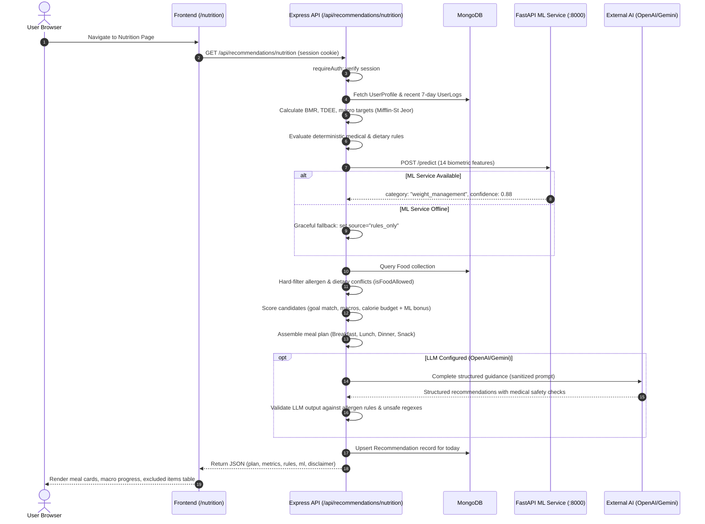

# System Architecture & Integration Audit — CEP_Project

**Audit Date:** 2026-10-16  
**Auditor:** Principal Software & System Architect  
**Repository:** `CEP_Project`  
**Git HEAD:** `c73d342`  

---

## 1. System Overview & Component Topology

`CEP_Project` is an AI-assisted personal nutrition, physical activity, and wellness recommendation system. It employs a **hybrid architecture** combining:
1. **Deterministic Clinical & Safety Rules**: Non-negotiable boundaries for allergens, medical contraindications, and metabolic mathematics (BMR via Mifflin-St Jeor, TDEE, macronutrient splits).
2. **Machine Learning Classifier**: A 200-tree scikit-learn Random Forest ensemble (`ai-ml/`) classifying biometric states into 6 lifestyle focus categories.
3. **Generative LLM Assistant / Enhancer**: An optional external LLM layer (OpenAI / Gemini / LLaMA) providing conversational support and structured advice under strict medical safety guardrails.
4. **Client Web SPA**: React 18 single-page application built with Vite and vanilla CSS.
5. **Application Backend**: Node.js Express monolith with Mongoose (MongoDB) and session-based state.

```mermaid
flowchart TD
    subgraph Client ["Frontend Client (React 18 + Vite :5173)"]
        UI[Pages & Navigation]
        AuthCtx[Auth Context & Session]
        APIClient[Centralized API Client]
        UI --> AuthCtx
        UI --> APIClient
    end

    subgraph Backend ["Backend API Service (Express + Node.js :5000)"]
        CorsMW[CORS & Security Headers]
        SessMW[Session Middleware / MongoStore]
        RateMW[Rate Limiters]
        Router[API Route Dispatcher]
        Controllers[Controller Layer]
        Services[Service Layer]
        RuleEngine[Deterministic Rule Engine]
        
        CorsMW --> SessMW --> RateMW --> Router --> Controllers --> Services
        Services --> RuleEngine
    end

    subgraph MLService ["AI/ML Subsystem (FastAPI + Python :8000)"]
        FastAPI[FastAPI Endpoints]
        FeatEng[Feature Engineering / 14 Biometrics]
        RFModel[Random Forest Classifier (200 Trees)]
        FastAPI --> FeatEng --> RFModel
    end

    subgraph ExternalAI ["External Generative LLM (Optional)"]
        OpenAI[OpenAI gpt-4o-mini]
        Gemini[Google Gemini 1.5 Flash]
        LLaMA[Local LLaMA Compatible]
    end

    subgraph Database ["Persistent Storage (MongoDB :27017)"]
        MongoUsers[(Users)]
        MongoProfiles[(UserProfiles)]
        MongoLogs[(UserLogs)]
        MongoRecs[(Recommendations)]
        MongoFeedback[(Feedback)]
        MongoFoods[(Foods)]
        MongoActivities[(Activities)]
        MongoRuns[(MLTrainingRuns)]
        MongoSessions[(Sessions)]
    end

    APIClient -- "HTTP / Session Cookie" --> CorsMW
    Services -- "HTTP /predict" --> FastAPI
    Services -- "REST API" --> ExternalAI
    Backend -- "Mongoose ODM" --> Database
    SessMW -- "Session Storage" --> MongoSessions
```

---

## 2. Subsystem Responsibilities & Module Boundaries

### 2.1 Frontend Subsystem (`frontend/`)
- **Framework & Tooling:** React 18.3.1, Vite 5.4.11, React Router DOM 6.28.0, Lucide React icons, Chart.js 4.4.7.
- **Entry & Bootstrap:** `index.html` -> `src/main.jsx` -> `src/App.jsx`.
- **State Architecture:**
  - `AuthContext`: Tracks session state, authenticated user metadata (`id`, `name`, `email`, `has_profile`), and session bootstrap via `/api/auth/me`.
  - `ToastContext`: Global notification dispatch.
  - Page-level async state: Handled uniformly via custom `useApi` hook (`src/hooks/useApi.js`) providing `data`, `error`, `loading`, and `reload`.
- **Route Layout:**
  - Public routes: `/login`, `/register`.
  - Protected layout (`AppLayout`): `/dashboard`, `/profile`, `/nutrition`, `/activity`, `/weekly-plan`, `/wellness`, `/logs`, `/progress`, `/feedback`, `/assistant`, `/ml`.
  - Responsive layout: Collapsible desktop sidebar and sliding drawer for mobile devices.
- **API Communication:**
  - Single API gateway: `src/services/api.js`.
  - Automatically sends cookies (`credentials: 'include'`).
  - Standardizes error responses into `ApiError` instances.

### 2.2 Backend Subsystem (`backend/`)
- **Framework & Server:** Node.js, Express 4.21.2, Mongoose 8.9.3.
- **Entry Points:**
  - `src/server.js`: Server startup, database connection, port binding.
  - `src/app.js`: Express application factory (`createApp`) allowing dependency injection of session stores for testing.
- **Middleware Pipeline:**
  1. Security headers: `X-Content-Type-Options: nosniff`, `X-Frame-Options: DENY`, `X-XSS-Protection: 1; mode=block`, `Referrer-Policy: strict-origin-when-cross-origin`.
  2. JSON parser with 1MB body limit (`express.json({ limit: '1mb' })`).
  3. CORS middleware supporting configured origins with credentials.
  4. Session middleware (`express-session` backed by `connect-mongo` in dev/prod, in-memory store in tests).
  5. Authentication middleware (`requireAuth` via `src/middleware/auth.js`).
  6. Central error handling (`src/middleware/errorHandler.js`).
- **Data Models:**
  - `User`: Basic identity and bcrypt password hash.
  - `UserProfile`: Full biometric and lifestyle parameters (age, gender, height, weight, activity level, dietary preference, allergies, goals, sleep, medical history).
  - `UserLog`: Daily tracking entries (water, sleep, steps, exercise minutes, calories, mood, stress, weight).
  - `Recommendation`: Daily persisted recommendation snapshots (food IDs, activity IDs, summary, ML prediction, confidence).
  - `Feedback`: User ratings and outcomes on recommendations.
  - `Food`: Food database items with macros, calories, allergen tags, and dietary flags.
  - `Activity`: Exercise options with MET values, duration, and intensity.
  - `MLTrainingRun`: Retraining audit log records.

### 2.3 AI/ML Subsystem (`ai-ml/`)
- **Framework:** FastAPI 0.115.6 / Python 3.10+, scikit-learn 1.6.0, joblib, pandas, numpy.
- **Service Endpoints (`app/main.py`):**
  - `GET /health`: Service health and config flag.
  - `POST /predict`: Feature vector ingestion and classification.
  - `GET /model/metadata` & `GET /model/explanation`: Architecture, training samples, metrics, confusion matrix, feature importances.
  - `POST /train` & `POST /retrain`: Dataset generation and model retraining.
- **Feature Engineering Pipeline (`app/features/engineering.py`):**
  - Derives 14 biometrics: `bmi`, `age`, `activity_score`, `sleep_hours`, `sleep_adequacy`, `hydration_ratio`, `hydration_adequacy`, `exercise_minutes`, `exercise_adequacy`, `steps_ratio`, `calorie_ratio`, `stress_level`, `goal_code`, `gender_code`.
- **Classification Engine (`app/prediction/predictor.py`):**
  - Random Forest Classifier with 200 trees, `max_depth=12`, `min_samples_leaf=3`, `class_weight='balanced'`.
  - Predicts 1 of 6 focus categories: `activity_focus`, `balanced_wellness`, `fitness_improvement`, `hydration_focus`, `sleep_focus`, `weight_management`.
- **Hybrid Fallback Guarantee:**
  - If the FastAPI service is unreachable or model loading fails, `backend/src/services/mlService.js` catches the error and cleanly falls back to deterministic rule-based output (`source: 'rules_only'`).

---

## 3. Data Flow & Integration Patterns

### 3.1 Recommendation Generation Flow


---

## 4. Architectural Defects & Technical Debt Discovered

### ARCH-01: Circular Workspace Dependency Declaration (P3)
- **Files:** `backend/package.json` (line 21), `frontend/package.json` (line 18).
- **Defect:** Both `backend/package.json` and `frontend/package.json` declare `"wellness-system": "file:.."` as a dependency. Neither package imports `wellness-system`. This creates an unnecessary circular link in the npm workspace tree and can cause issues during isolated Docker builds.
- **Remediation:** Remove the unused `"wellness-system": "file:.."` entry from both `backend/package.json` and `frontend/package.json`.

### ARCH-02: Hardcoded Localhost Binding in Server Startup (P2)
- **File:** `backend/src/server.js` (line 8).
- **Defect:** `app.listen(env.port, '127.0.0.1', ...)` hardcodes the binding address to `127.0.0.1`. Inside containerized environments (Docker, Kubernetes) or cloud platforms (Render, Railway, ECS), listening on loopback prevents incoming traffic from being routed to the container.
- **Remediation:** Make the bind host configurable via environment variable (e.g., `HOST` defaulting to `0.0.0.0` or `127.0.0.1`).

### ARCH-03: Missing Graceful Process Shutdown (P2)
- **File:** `backend/src/server.js`.
- **Defect:** No handlers for `SIGTERM` or `SIGINT`. When the container orchestrator sends a termination signal, existing in-flight HTTP requests and database operations are abruptly aborted.
- **Remediation:** Implement graceful shutdown that closes the HTTP server, stops accepting new connections, and terminates the Mongoose connection cleanly.

### ARCH-04: Model Persistence Ambiguity (`model.pkl` vs `random_forest_model.joblib`) (P2)
- **Files:** `ai-ml/app/config.py` (line 10), `ai-ml/models/`.
- **Defect:** `config.py` specifies `MODEL_PATH = ... / "model.pkl"`. However, `.gitignore` ignores `model.pkl`, whereas `random_forest_model.joblib` is tracked in git. On a clean clone, `model.pkl` is missing, causing `predictor.py` to fail unless `random_forest_model.joblib` is used or the model is retrained.
- **Remediation:** Add fallback detection in `config.py` or `predictor.py` so that if `model.pkl` is absent, it loads `random_forest_model.joblib`.

### ARCH-05: Inconsistent MongoDB Environment Variable Names (P3)
- **Files:** `backend/src/config/env.js` (uses `MONGO_URI`), `backend/src/seed/dedupe.js` (uses `MONGODB_URI`).
- **Defect:** `dedupe.js` checks `process.env.MONGODB_URI`, whereas the rest of the application and `.env.example` standardize on `MONGO_URI`.
- **Remediation:** Update `dedupe.js` to import `env` from `../config/env` or accept `process.env.MONGO_URI || process.env.MONGODB_URI`.

---

## 5. Architectural Quality Attributes Assessment

| Quality Attribute | Rating | Assessment |
|---|---|---|
| **Separation of Concerns** | **Strong** | Controllers handle HTTP, services contain business logic, rules engine encapsulates medical/dietary heuristics. |
| **Fail-Safe Defaults** | **Excellent** | If ML or LLM services are offline, the deterministic engine safely computes 100% compliant recommendations. |
| **Modularity** | **Good** | Clean decoupling between ML training, prediction API, and backend Express consumer. |
| **Observability** | **Needs Work** | Uses raw `console.log` / `console.error`. Lacks structured JSON logging (Winston/Pino), correlation IDs, or metrics endpoints. |
| **Deployment Readiness** | **Needs Work** | No Dockerfile, docker-compose, or CI/CD workflow defined in the repository. |
